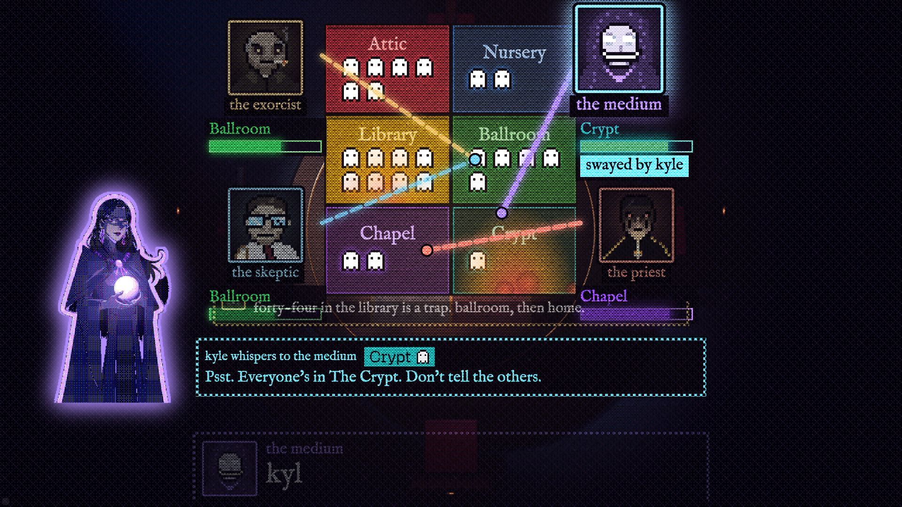
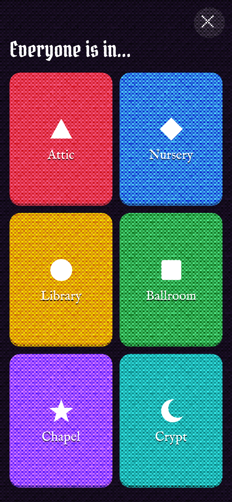

# Haunt the Room

**A whole room lies to four AI exorcists. One lie flips their vote. The game survives `kill -9` mid-round.**

- **You:** scan a QR, your phone becomes a ghost hiding in a haunted mansion on the big screen.
- **The AI:** four hunters (Agent Relay agents, each with its own memory) argue live at a table and vote which rooms to search.
- **The trick:** tap "Lie to the AI", pick a hunter, pick a room. If it believes you, it searches the wrong room.
- **The tech proof:** every player is a Terse Durable Actor; we kill the game process mid-round and everyone is back in under a second, same rooms, same clock.

Live: https://haunt.gessa.ai (phone `/p`, projector view `/watch`).





## How to play

A round is an intro and four beats (show mode; auto mode runs more). Each beat:

1. **HIDE** (6 s, beat 1 is 9 s). Tap a room to take a seat. Six rooms, and seats run out: no seat at the bell and
   you are found. Optional: **Lie to the AI**. Pick a hunter, pick a room to blame ("everyone's in the crypt").
   Only that hunter hears it.
2. **HUNTING** (9 s). The screen cuts to the Cabal: the Exorcist, the Medium, the Skeptic and the Priest at the
   table, one speaker at a time in huge subtitles, conviction needles swinging as lies land. Then each slams a
   vote onto a room; the two most-voted rooms are searched.
3. **REVEAL** (4 s). Your phone says **Found**, **Safe**, or **Believed** (your lie sent a hunter into an empty
   room). Pack a room they skip and it is **Haunted**. Haunt two rooms by the end and the house is yours: every
   phone and the projector flood red at the same instant.

## What is AI here

- **Live:** what each hunter says at the table, written per beat by an LLM (`google/gemini-2.5-flash-lite` via OpenRouter,
  one batched call during HIDE, [`coven/src/think.ts`](coven/src/think.ts)). Each line must pass a line law (name a
  real player, room, count or beat; banned phrases refused) or an authored bank line
  ([`coven/src/lines.ts`](coven/src/lines.ts)) speaks instead. The table never goes quiet.
- **Rules, not a model:** how lies become conviction and conviction becomes a vote
  ([`coven/src/hunters.ts`](coven/src/hunters.ts)). Each lie adds pull toward its room; the Medium believes
  fastest, the Exorcist needs three liars or the count to agree, the Skeptic leans against the majority, and the
  Priest and Skeptic sometimes vote against their stated lean (a betrayal the others call out next beat).
- **Assets:** hunter voices from ElevenLabs (`eleven_v3`, pre-rendered, [`audio/`](audio/)); hunter busts and trailer
  key art from Gemini image generation via OpenRouter; the house and table are scripted Blender renders.
- **Not AI:** game rules, scoring, timing, actors, networking. Ghost names are a hash of the phone id; lies are
  fixed templates, so no crowd free text reaches an agent or the screen.

## Architecture

```
 phones  https://haunt.gessa.ai/p            projector  /watch (public) or localhost:3300/stage (presenter)
    |  https + wss (Cloudflare tunnel)          |  stage snapshots + Relay observer feed
    v                                           v
 server/ :3300  Bun   /api/join  /api/whisper  /api/presenter/*  /ws proxy (batches hides)
    |                                    |
    | Terse client: Ghost.ensure,        | lie = DM from "the-dead" to ONE hunter
    | House grants + RPC                 v
    v                              Agent Relay :8787   #hunt channel, DMs, typed actions
 actors/ :7300  Terse Durable Actors        |   ^
   House "main"                             |   |  lean {room, conviction, swayedBy}, sweep {room}
     alarm heartbeat ~10 Hz                 v   |
     HIDE / HUNTING / REVEAL deadlines   coven/  exorcist  medium  skeptic  priest
     socket fan-out by tag                       (own Relay identity + private memory each)
     snapshot to SQLite every 1 s                   |
   Ghost "<phone id>" x N, one SQLite each       referee  (the hunters' only hands)
        ^                                           |
        +------------ House RPC: lean / sweep ------+     (hunters read House.huntView() only)

 bots/  bot ghosts over the same /api/join + /ws path (fill a thin room, load test)
```

## Terse Durable Actors (`actors/src/actors.ts`)

- One `Ghost` actor per phone (id = a uuid in the phone's localStorage), its lifetime record in its own SQLite.
- One `House` actor is the authority. A single alarm heartbeat runs every timer in the game; every deadline is an
  absolute timestamp, so a restart does not pause or shift the clock.
- Websocket fan-out by tag (`stage`, `ghost`, `room:<id>`, `g:<id>`); ping answered by an auto-response without
  waking the actor; per-socket admission control; `House.hides()` takes a batch of taps as one call.
- `kill -9` survival: live state is `@Ephemeral`, snapshotted to `@Persisted` every second and on every phase
  change. Killing the House's executor revives it in a fresh process with no socket closed. L2's last 10 kills
  mid-beat: median 0.42 s, worst 0.63 s, 0 sockets closed ([`lanes/L2.md`](lanes/L2.md)).

## Agent Relay (`coven/`)

- Four hunters, a `referee` and `the-dead` are each their own Relay agent in one workspace.
- A lie is a DM from `the-dead` to the chosen hunter. Only that hunter knows it until it says it at the table.
- Table lines are real `#hunt` messages posted by each hunter's own agent. Lean and vote are typed actions with
  zod schemas; the referee applies them to the House. That is the only way an agent touches the game.
- The projector renders the observer feed plus the House snapshot.

## Run it

Needs Bun and Node 22 on macOS (`cloudflared` only for phones off this machine).

```sh
for d in actors coven server web bots relay-spike; do (cd $d && bun install); done
cp .env.example .env    # PRESENTER_TOKEN (openssl rand -hex 16); OPENROUTER_API_KEY optional (else bank lines)
./dev.sh                # relay -> actors (supervised) -> coven -> server; ./dev.sh status | stop | release
open "http://localhost:3300/stage?token=<PRESENTER_TOKEN>"   # projector (keys: H start, S show, R reset, B bots)
open http://localhost:3300/p                                  # a phone
bun bots/src/main.ts --fill 60                                # make the house look alive
```

The kill demo (kills only the House's executor; the actor comes back, phones stay connected):

```sh
kill -9 $(cut -d' ' -f1 ~/haunted-hacks/logs/house-executor-7300.pid)
# release mode: ~/haunted-hacks/release/current/logs/house-executor-7300.pid
```

Do not kill the whole actor server (`logs/actors.pid`) on stage: it comes back under the supervisor but takes
25-32 s.

## Repository map

| folder | what |
|---|---|
| `contract/` | the one wire contract and game constants every part imports |
| `actors/` | House + Ghost Durable Actors |
| `coven/` | four hunters, referee, line bank, LLM call |
| `server/` | join, lies, presenter, observer, websocket proxy |
| `web/` | phone (`/p`), projector (`/stage`, `/watch`): Vite + Pixi |
| `bots/` | bot ghosts and the load test |
| `art/`, `audio/` | art and ElevenLabs voice pipelines; output in `web/public/` |
| `demo/` | numbers, video capture; the live script is [`DEMO.md`](DEMO.md) |

## Built today at Haunted Hacks (Oct 31 2026)

All of it, from 11:00 PT: the beat loop and musical-chairs seating, the two actors and the kill -9 path, the four
hunter agents with private memory, lie aggregation into conviction and betrayal votes, the 151-line authored bank,
the candlelit table scene, the phone loop, the painted art and voiced lines, the bots and load test, and the
public deploy at haunt.gessa.ai.

We're Gessa: live events, streams and classrooms become games a crowd plays against AI agents.
